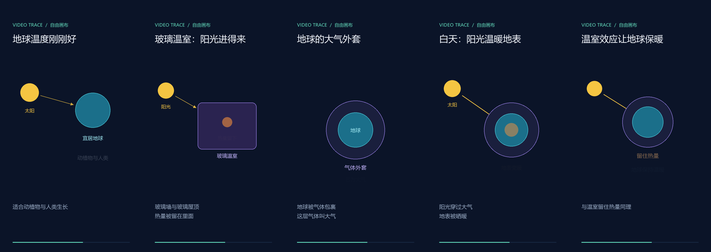
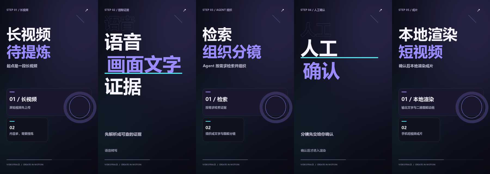

# VideoTrace

AI 视频理解与创作平台。通过语音转写、画面文字识别和大语言模型，将视频转化为带时间戳的内容证据，再通过创作 Agent 完成选题讨论、分镜生成和二维图解动画短视频制作。

适用于课程、会议、访谈、发布会和操作教程等场景。用户可以先讨论创作方向，也可以直接提出明确需求；分镜生成后可询问依据、局部修改，经人工确认后渲染成片。

## 功能

- **视频导入**：本地文件上传及在线视频链接导入（需配置受控出口代理）；大文件支持分片上传、断点续传和分片校验。
- **异步解析**：提取语音转写（ASR）与关键帧文字（OCR），持久化阶段结果，中断后复用已完成阶段。
- **目标驱动分析**：围绕用户目标执行规划、分析与校验流程，生成结构化结果。
- **视频证据检索**：对内容分块，结合 BGE 语义检索与本地 BM25，通过 RRF 排名融合选取相关片段，为创作讨论与分镜生成提供证据。
- **创作对话**：模型判断讨论、生成或修改意图；模糊需求先讨论，明确需求或授权自行决定时直接生成分镜。讨论和解释不会增加分镜版本。
- **分镜与成片**：生成关联时间戳证据的结构化分镜，支持指定场景修改；人工确认后输出含文字卡片、二维物体图解及可选背景音乐的竖屏 MP4。
- **二维图解动画**：10 种常用物体、6 种布局、3 套主题，支持滑入、脉冲、连线绘制与逐项出现；Agent 选择预设元素和关系，渲染器确定性执行。
- **自由画布动画**：Agent 可组合圆形、矩形、文字、图标和连线，自行安排坐标、尺寸与层级；每幕最多 20 个元素，每元素最多 4 个关键帧，支持位移、缩放、透明度和缓动。程序校验引用、动画边界与文字排版，错误交回 Agent 修正。
- **发布会与动态文字风格**：大字号标题、渐变背景、错峰拼版卡片、描边文字与遮罩揭示；支持淡化、推移及擦除衔接，适合短节奏信息视频。
- **证据定位**：将分析结果和检索片段关联到原视频时间戳，点击查看对应内容。
- **任务进度**：视频分析通过 SSE 推送状态，创作工作台轮询任务进度；支持失败重试和已生成作品预览。

当前内容理解主要依赖语音和画面文字；遇到文本无法解释的图表或界面时，Agent 可按需调用 `inspect_video_frame` 理解已检索证据内的画面。该工具与批量 OCR 分离，每轮最多调用两次，尚未覆盖连续人物动作理解。

创作不剪辑原视频，不生成写实画面或 AI 配音。旧版独立问答入口保留，创作对话直接复用视频证据检索能力，不依赖旧问答记录。

## 动画演示

### 真实视频 → 自由画布

[观看或下载 15 秒《温室效应》样片](examples/greenhouse-canvas/demo-15s.mp4)



素材来自 [NASA《What Is the Greenhouse Effect?》](https://science.nasa.gov/kids/videos/video-what-is-the-greenhouse-effect/)前 55 秒真实画面与旁白。先完成上传、ASR/OCR、分析，再复用持久化证据，由 DeepSeek 检索并生成自由画布分镜；太阳、地球、温室、大气与箭头的位置及动画由模型编排。中间图形自由组合，页眉页脚仍由系统绘制。[分镜 JSON](examples/greenhouse-canvas/storyboard.json) · [验证记录](examples/greenhouse-canvas/verification.json)。

原始解析与创作渲染链路已验证；自由画布对照复用同一解析结果，没有重新调用 ASR/OCR。首轮画布生成因文字溢出耗尽修复预算，改进为批量返回排版问题后重试通过。分析阶段仍有部分结论需人工核验的提示，本样片不代表大规模内容质量评测。

### 发布会 / 动态文字

**视频如何变成短视频**：原始视频 → 语音与画面文字 → Agent 汇集证据 → 分镜 → 手机成片。

[观看或下载 15 秒发布会 / 动态文字样片](examples/motion-demo/demo-15s.mp4)



这支样片为 720×1280、24 FPS，由真实 DeepSeek 根据合成演示文本生成五幕分镜，再由本地渲染器生成文字、卡片、动画和配乐。检索使用固定演示数据，不代表真实上传视频的完整端到端质量验收。[查看分镜 JSON](examples/motion-demo/storyboard.json) · [渲染协议与验证说明](docs/diagram-rendering.md)。

也保留了 [30 秒基础二维图解样片](examples/diagram-demo/demo.mp4)及其[分镜](examples/diagram-demo/storyboard.json)，该旧样片由手工分镜生成。

## 技术栈

| 层级 | 技术 |
| --- | --- |
| 后端 | Java 21、Spring Boot、MyBatis-Plus、LangChain4j |
| 前端 | Vue 3、Vite |
| 创作服务 | Python 3.11、FastAPI、LangGraph、Pydantic、SQLite Checkpoint |
| 数据与缓存 | MySQL、Flyway、Redis、Redisson |
| 异步任务 | RocketMQ |
| 对象存储与向量检索 | MinIO、Qdrant |
| 媒体处理 | FFmpeg、ffprobe、Tesseract、yt-dlp |

## 处理流程

```text
本地上传 / 视频链接
        ↓
MinIO 存储 + MySQL 媒体记录
        ↓
持久投递记录 → RocketMQ → 分析任务执行
        ↓
ASR 语音转写 + 关键帧 OCR
        ↓
阶段结果持久化 → 内容分块与向量索引
        ↓
创作对话 → 模型意图路由
        ↓
讨论与澄清 / 生成分镜 / 修改已有分镜
        ↓
按需检索证据与上下文 → 结构化校验与有限修正
        ↓
人工确认分镜 → FFmpeg 渲染 → MinIO 成片存储
```

Java / Spring Boot 负责鉴权、视频归属、解析与检索、对话消息和业务任务状态；Python / FastAPI 提供内部任务接口，LangGraph 负责模型决策和工具执行。创作使用 MySQL 持久任务队列与内部 HTTP 接口，视频解析使用 Outbox + RocketMQ，两条链路各自管理重试。

创作 Agent 通过 `choose_action` 选择讨论、生成或修改，再按阶段开放 `search_video`、`read_context`、`inspect_video_frame`、`finish_discussion`、`save_storyboard` 或 `patch_scenes`。渲染不作为模型工具开放，只能由用户确认触发。分镜版本校验拒绝过期请求，操作标识、重试次数和回调序号校验阻止迟到结果更新当前任务；未变场景可复用渲染缓存。

后端围绕长耗时任务实现了以下机制：

- **可靠投递**：先保存任务投递记录，再发送 MQ 消息，定时扫描并补偿失败投递。
- **执行恢复**：通过租约、心跳和条件更新管理任务归属，回收并重新调度过期任务。
- **阶段复用**：保存 ASR、OCR 阶段结果与 AI 工作流检查点，减少恢复时的重复处理。
- **资源控制**：隔离处理线程池，限制本地并发与跨实例调用频率，并设置 AI 执行预算。

## 混合证据检索

- DeepSeek 根据查询生成语义检索意图与关键词；BGE 生成查询向量。关键词提取调用模型，BM25 打分与 RRF 融合均在 Java 本地完成。
- 以当前视频的内容块为语料，BM25 统计词频、文档频率与长度，参数为 `k1=1.2`、`b=0.75`；文本覆盖片段摘要、关键词、ASR 和 OCR。实现依据 [Lucene BM25 公式说明](https://lucene.apache.org/core/9_12_3/core/org/apache/lucene/search/similarities/BM25Similarity.html)，没有引入 Lucene 或 Elasticsearch 服务。
- 词项采用 NFKC 规范化、大小写归一、中文相邻双字切分，英文和带连接符的产品型号保留完整词项。当前不使用词典分词，单字查询和复杂专名仍有改进空间。
- 语义排名与 BM25 排名通过 RRF（`k=60`）融合，取前三个内容块；块内时间片段再结合块排名、ASR/OCR 的 BM25 排名融合，去重后返回时间戳证据。非正分数不参与排名，没有有效匹配时返回空结果。
- 向量库不可用时可使用已有片段向量计算余弦相似度；查询向量接口不可用时使用 BM25。统计范围仅限当前视频，尚未引入跨视频语料或持久化词项索引。
- 回归样例覆盖中文、精确型号（如 X100 与 X1000）、语义改写、词频/稀有度/长度差异和服务降级；尚无大规模标注数据集上的召回率提升结论。

## 快速开始

以下命令在项目根目录执行，示例使用 PowerShell。

### 环境要求

- JDK 21 或更新版本，Maven 3.9+（也可使用项目 Maven Wrapper）
- Node.js 22.12+ 与 npm
- Python 3.11（创作服务已验证版本，也用于后端启动脚本）
- Docker 与 Docker Compose
- FFmpeg、ffprobe、Tesseract；使用视频链接导入时还需 yt-dlp
- 可调用的 LLM、Embedding 和 ASR 服务凭据

将 `java`、`ffmpeg`、`ffprobe` 和 `tesseract` 加入 PATH。Tesseract 需安装 `chi_sim` 与 `eng` 语言数据。

### 1. 配置环境变量

```powershell
Copy-Item .env.example .env
```

编辑 `.env`，填写模型服务密钥并替换示例密码：

| 配置 | 说明 |
| --- | --- |
| `SILICONFLOW_API_KEY`、`SILICONFLOW_BASE_URL` | 硅基流动凭据和地址，仅供 BGE Embedding 与 ASR 使用 |
| `LLM_API_KEY`、`LLM_BASE_URL`、`LLM_MODEL` | Java 分析、摘要、检索意图与问答的 LLM；示例使用官方 DeepSeek |
| `EMBEDDING_MODEL`、`ASR_MODEL` | 向量模型及语音识别模型 |
| `DB_USERNAME`、`DB_PASSWORD` | 应用数据库账号；`MYSQL_APP_USER` 应与 `DB_USERNAME` 一致 |
| `MYSQL_ROOT_PASSWORD` | Compose 初始化 MySQL 使用的 root 密码 |
| `REDIS_PASSWORD` | Redis 密码 |
| `MINIO_ACCESS_KEY`、`MINIO_SECRET_KEY` | MinIO 凭据 |
| `QDRANT_API_KEY` | Qdrant 凭据 |

完整配置见 [.env.example](.env.example) 和 [application.properties](server/src/main/resources/application.properties)。不要将真实密钥或 `.env` 提交到版本库。

### 2. 启动基础设施

```powershell
docker compose up -d --build
docker compose ps
```

Compose 启动 MySQL、Redis、MinIO、Qdrant 和 RocketMQ。首次构建 MinIO 镜像需要下载并编译源码，可能耗时较长。

确认服务就绪后再启动后端。数据库默认名为 `videotrace`，表结构由 Flyway 管理。

### 3. 构建并启动后端

```powershell
mvn -f server/pom.xml -s server/.mvn/central-settings.xml package -DskipTests
New-Item -ItemType Directory -Force docs | Out-Null
python scripts/run-backend.py
```

启动脚本读取根目录 `.env` 并运行构建后的 JAR；`docs/` 用于保存本地进程记录。后端默认监听 `http://localhost:9090`。

没有安装 Maven 时，可用以下命令替代构建命令：

```powershell
Push-Location server
.\mvnw.cmd -s .mvn/central-settings.xml package -DskipTests
Pop-Location
```

### 4. 配置并启动 Python 创作服务

在项目根目录创建独立环境：

```powershell
py -3.11 -m venv creator/.venv
creator/.venv/Scripts/python.exe -m pip install -r creator/requirements-lock.txt
```

在根目录 `.env` 中配置以下参数，然后重新启动 Java 后端，使两端读取相同的内部认证令牌：

| 配置 | 说明 |
| --- | --- |
| `CREATOR_ENABLED` | Java 创作入口开关 |
| `CREATOR_INTERNAL_TOKEN` | 两端共用的随机令牌，至少 32 个字符；留空拒绝内部访问 |
| `CREATOR_URL`、`CREATOR_JAVA_URL` | 分别默认 `http://127.0.0.1:8091`、`http://127.0.0.1:9090` |
| `CREATOR_LLM_BASE_URL`、`CREATOR_LLM_API_KEY`、`CREATOR_LLM_MODEL` | 创作模型的地址、密钥和模型名；使用支持工具调用的 OpenAI 兼容 Chat Completions 接口 |
| `CREATOR_LLM_OPTIONS` | 可选 JSON 请求参数；值为 `null` 时移除对应默认参数 |
| `CREATOR_MINIO_ENDPOINT`、`CREATOR_MINIO_BUCKET` | 与 Java 可访问的对象存储地址和桶一致 |
| `CREATOR_MINIO_ACCESS_KEY`、`CREATOR_MINIO_SECRET_KEY` | 单独配置的受限存储账号，允许读取/写入目标桶的 `creations/*`；不要使用管理员账号 |
| `CREATOR_DATA_DIR` | SQLite 状态和渲染缓存目录，默认 `creator/data`，需持久保存 |
| `CREATOR_FONT_PATH` | 中文字体路径；Windows 自动检测微软雅黑，Linux 可指定 Noto Sans CJK |

创作模型覆盖项未设置时沿用 `LLM_API_KEY`、`LLM_BASE_URL`、`LLM_MODEL`；旧配置未设置独立 LLM 地址或密钥时仍兼容回退到 `SILICONFLOW_*`。更换创作模型不改变 Java 的 ASR、Embedding 服务配置。DeepSeek 官方接口默认禁用 thinking，以兼容强制工具调用；其他服务不附带 DeepSeek 专用字段。当前工作流不保留多轮 `reasoning_content`，请使用非思考模式。修改配置后重启创作服务生效。

```powershell
creator/.venv/Scripts/python.exe -m uvicorn creator.app:app --host 127.0.0.1 --port 8091 --env-file .env
```

当前只支持单个 Python 服务进程，不要启用多个 worker。渲染依赖锁定环境中的 MoviePy 和 imageio-ffmpeg；Java 视频解析仍需系统 FFmpeg、ffprobe 和 OCR 工具。

### 5. 启动前端

在另一个终端执行：

```powershell
cd client
npm ci
npm run dev
```

打开终端显示的地址，默认是 `http://localhost:5173`。注册并登录后，上传视频并完成内容解析，再进入“短视频创作”。只有转写文本、没有当前版本的时间戳上下文时，还不能创作。

选择成片时长，输入“这个视频有哪些值得做的选题？”开始讨论，或明确要求提炼内容并生成分镜。已有分镜时可询问依据或勾选场景提出修改；检查结果后点击确认按钮生成视频。

当前界面支持 15、30、45、60 秒，时长以选择器为准；文字要求冲突时先澄清，更改时长需新建对话。单会话最多 200 条消息，模型读取最近最多 20 条、总计不超过 24000 字符的历史，旧消息仍保留在界面。意图判断由模型完成，不保证所有表达都能正确识别。

前端开发服务器通过代理访问后端，目标地址由根目录 `.env` 的 `VITE_DEV_PROXY_TARGET` 配置。

## 配置说明

- **模型服务**：示例配置将全部 LLM 调用指向官方 DeepSeek，BGE 和 ASR 留在硅基流动。Java 与 Python 可共享 LLM 配置，创作也可单独覆盖；切换后重启对应服务。ASR 地址可通过 `ASR_URL` 配置。
- **解析版本**：调整提取规则或 ASR／OCR 模型后，更新 `VIDEO_PARSE_VERSION`，区分解析结果与相关缓存。
- **资源限制**：通过 `MEDIA_PROCESS_CONCURRENT`、`*_CALL_CONCURRENT` 和 `*_CALLS_PER_MINUTE` 调整并发与频率；各 Worker 应使用一致的共享频率配置。
- **AI 预算**：通过 `AGENT_MAX_ROUNDS`、`AGENT_MAX_DURATION_MS` 和 `AGENT_MAX_ESTIMATED_TOKENS` 限制执行消耗。启用成本预算时需同时配置输入、输出 Token 单价。
- **视频链接**：`YTDLP_PROXY` 留空时关闭链接导入，本地上传不受影响。启用前须配置 `http://host:port` 形式的受控 HTTP 代理，逐次阻止访问本机、内网、链路本地、保留网段和云元数据地址，并在网络层阻止下载进程及子进程绕过代理直连。普通代理本身不提供这些安全保障。部分站点需要登录 Cookie，可配置 `YTDLP_COOKIES` 或 `YTDLP_COOKIES_FROM_BROWSER`，前者优先。

## 测试与构建

后端测试：

```powershell
mvn -f server/pom.xml -s server/.mvn/central-settings.xml test
```

真实 MySQL Mapper 测试需额外配置 `VIDEOTRACE_TEST_JDBC_URL`、`VIDEOTRACE_TEST_DB_USER` 和 `VIDEOTRACE_TEST_DB_PASSWORD`；未配置时跳过。

前端测试与生产构建：

```powershell
cd client
npm test
npm run build
```

Python 创作服务测试（在项目根目录执行）：

```powershell
creator/.venv/Scripts/python.exe -m unittest discover -s creator -t . -p 'test_*.py' -v
```

创作集成验收（先完成后端打包、启动基础设施并配置 `.env`）：

```powershell
creator/.venv/Scripts/python.exe scripts/smoke-creation.py
```

该脚本使用真实 Java、Python、MySQL 和 MinIO，以及确定性的本地模拟模型；自动启动专用测试进程，验证讨论、直接生成、局部修改、幂等、权限、重启恢复及实际 MP4 渲染。结束时清理本次数据库测试记录和进程，保留本地及 MinIO 测试成片。仅在本地专用开发环境运行，脚本会复用 `.env` 中的测试存储账号。模拟模型测试不能作为真实模型质量评测。

真实 DeepSeek 已用模拟视频文本验证模糊需求、直接生成、暂停生成、分镜解释、局部修改、时长冲突及多轮选题衔接。尚未据此宣称真实上传视频与真实模型的完整端到端质量已通过验收。

`scripts/` 还提供上传、消息队列恢复和重启清理的冒烟检查脚本。部分脚本会改变服务状态，执行前请阅读对应脚本。

二维图解样片可独立复现，不依赖 Java、MinIO 或模型 API（需先安装 Python 依赖及中文字体）：

```powershell
creator/.venv/Scripts/python.exe scripts/render-diagram-demo.py
```

结果位于 `creator/data/diagram-demo/`，公开样片位于 `examples/diagram-demo/`。

自由画布的本地合成演示：

```powershell
creator/.venv/Scripts/python.exe scripts/render-canvas-demo.py
```

结果位于 `creator/data/canvas-demo/`，不调用外部 API。也可运行 `scripts/smoke-canvas-model.py --render`，使用已配置的真实创作模型生成自由画布并渲染；该命令会调用外部模型并产生费用，输入为合成演示文本，证据检索使用固定数据，不代表真实上传视频解析验收。详细结果与限制见 [二维图解渲染说明](docs/diagram-rendering.md)。

15 秒发布会 / 动态文字演示使用 `scripts/smoke-canvas-model.py --duration 15 --style motion --render`，同样会调用配置中的真实模型。后续 GPT 对照约定使用 Codex CLI 的 `gpt-6.1-sol`、`low` 强度；当前公开的新版 15 秒样片使用 DeepSeek。

## 项目结构

```text
VideoTrace/
├── client/                 # Vue 前端与交互测试
├── creator/                # FastAPI、LangGraph、模型客户端、分镜校验与渲染
├── server/
│   ├── src/main/java/      # API、任务调度、媒体解析与 AI 服务
│   ├── src/main/resources/ # 应用配置、数据库迁移与评测样例
│   └── src/test/           # 后端测试
├── scripts/                # 本地启动与冒烟检查
├── infra/minio/            # MinIO 镜像构建
├── rocketmq/               # Broker 配置
├── docker-compose.yml      # 本地基础设施
└── .env.example            # 环境变量示例
```

## 部署注意事项

当前 Compose 面向本地开发，服务端口默认绑定回环地址。对外部署时需配置 HTTPS、访问控制、备份与资源配额。

视频链接下载共享媒体处理并发配额，配额耗尽时返回繁忙提示。公网地址校验不能单独防止 DNS 重绑定或重定向到内网；启用链接导入必须落实上述代理与网络出口限制。

`/health` 当前仅用于检查 HTTP 服务是否响应，不代表数据库、队列或模型服务已就绪。任务恢复机制也不保证外部模型调用严格只执行一次。AI 回答可能存在遗漏或误判，关键内容应结合原视频证据核验。

## 测试记录与 API 配置

上传容量、四小时本地预处理测试结果，以及模型/API 配置项、生效方式和已知限制，见 [视频容量测试与 API 配置](docs/testing-and-api-configuration.md)。

## 许可证

本项目采用 [MIT License](LICENSE)。第三方依赖及服务遵循各自的许可证与使用条款。

