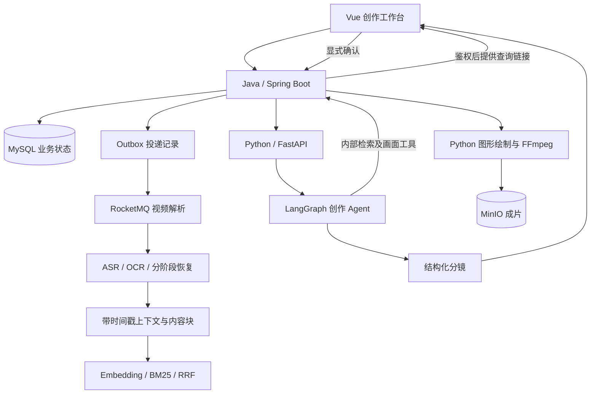
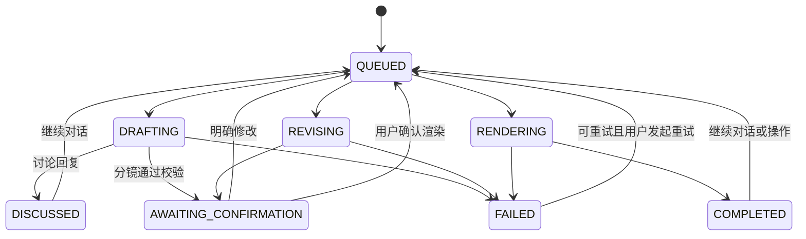

# 架构与状态流转

## 系统边界

VideoTrace 从已解析的视频证据出发，讨论创作需求、生成分镜，经用户确认后渲染文字及二维动画。当前没有调用文生视频模型，也不剪辑原片。模板版与自由画布版都由程序绘制画面。

| 部分 | 主要职责 | 不承担的职责 |
| --- | --- | --- |
| Vue | 上传、需求对话、选择时长、分镜预览与场景选择、确认和成片播放 | 不持有模型密钥或内部令牌 |
| Java | 登录、素材归属、上传、解析调度与证据检索、创作业务状态、回调校验 | 不负责每帧绘图 |
| Python | 内部操作接收、模型决策和工具执行、结构校验、渲染与成片上传 | 不接受客户端自报身份绕过素材归属 |
| MySQL | 上传会话、解析投递和执行记录、阶段结果、创作任务/操作/成片快照 | 不替代 MinIO 保存完整视频 |
| Redis | 登录会话、锁、共享限流及执行状态辅助 | 不能仅凭一个缓存状态证明任务已永久完成 |
| Qdrant | 当前解析版本的内容向量检索 | 不计算本地 BM25 |
| MinIO | 原片、分片、截图及成片对象 | 当前上传合并仍在 Java 本地完成 |
| Python SQLite | 操作、回调事件与 LangGraph Checkpoint | 不是多进程共享调度服务，当前只运行一个 Python worker |

对应入口：[CreationService](../server/src/main/java/com/videotrace/service/CreationService.java)、[创作 Agent](../creator/agent.py)、[Python 服务](../creator/app.py)。

## 两条异步任务链路

**视频解析**使用 MySQL Outbox + RocketMQ：先保存投递记录，再发送消息；扫描补偿失败投递，消费侧检查执行归属、重复任务和阶段状态。ASR、OCR 阶段结果持久化，可在重试时复用已完成分支。阶段恢复不等于每个音频片段都独立恢复，外部调用也不保证严格只发生一次。

**短视频创作**使用 MySQL 持久操作队列 + 内部 HTTP：Java 将操作发送到 Python，Python 用 SQLite 保存接收与执行状态；回调事件持久化后发送给 Java。它没有借用视频解析的 RocketMQ 队列。

Python 重启会恢复未完成操作并续传未确认回调。LangGraph Checkpoint 保存的是图状态，Java 业务任务状态仍以 MySQL 为准；两者不能互相替代。

## Agent 与固定流程的关系

创作流程是受约束的 Agent：模型在允许的阶段内决定是否检索、补查、讨论或提交分镜；鉴权、预算、持久化、确认和渲染由确定性代码控制。不能因使用 LangGraph 就把全部流程描述成模型自主决策。

| 阶段 | 可用能力 | 硬边界 |
| --- | --- | --- |
| 对话路由 | `choose_action` 判断 `DISCUSS/CREATE/REVISE` | 必须先路由，明确修改已有分镜才进入修订 |
| 讨论 | 检索、补查、必要时查看证据画面、`finish_discussion` | 不修改分镜，不触发渲染 |
| 生成 | `search_video`、`read_context`、按需 `inspect_video_frame`、实验 `review_storyboard_preview`、`save_storyboard` | 分镜必须关联检索所得证据，总时长匹配选择器 |
| 修订 | `patch_scenes`，需要时补查证据或调用实验预览检查 | 检查 `baseRevision`；指定目标场景时保护其他场景 |
| 渲染 | 用户确认后执行本地渲染和 MinIO 上传 | 不向模型开放渲染工具 |

当前每轮最多 8 次模型决策、12 次工具调用、2 次原视频画面查看及2次实验预览检查；结构修复最多 2 次，仍受执行时间预算约束。模型返回格式正确不代表事实正确，证据 ID 合法也不代表每句话均被原视频支持。

### 实验视觉反馈

`review_storyboard_preview` 渲染最多3幕的连续抽样帧，调用可配置多模态模型返回视觉建议，再由 Agent 决定是否修改。它没有业务保存或最终视频发布副作用，不增加分镜版本。成功结果缓存能减少重复调用，但不能保证外部模型请求严格只执行一次。

保存日志记录最新预览的分镜指纹是否与最终分镜一致；有反馈不等于最终版本已通过检查，检查后修改的分镜应明确区分。预览服务失败仍可保存合法分镜等待人工审阅。[参数、效果和复现](visual-playground.md)。

## 创作业务状态

该图表达主要业务路径，并非穷尽所有回调转换。Python 操作表的 `PENDING/RUNNING/DONE/FAILED` 是另一层状态；例如一次讨论操作为 `DONE` 时，Java 任务可能是 `DISCUSSED`，并不意味着已有视频。

## 版本、幂等与迟到结果

- 客户端 `requestId` 表示一次操作意图；同一请求丢失响应后复用，改变内容时生成新 ID。
- `baseRevision` 防止旧分镜修改或旧确认请求作用于新版本；这不是整个并发协议的全部。
- `operationId`、`attempt`、事件 `sequence` 和当前操作校验，防止旧执行或迟到回调改写当前任务。
- 渲染结果还检查确认版本、对象路径、大小和哈希格式。旧版本作品可以按版本读取，不应被当作当前分镜的新成片。
- 素材归属、解析版本及时间戳上下文在内部检索与后续操作中重新检查；删除原片后，已有成片仍可读取，但不能继续修改和渲染。

## 渲染模式

`motion` 使用设计好的发布会/动态文字组件；`canvas` 使用受约束的图形与关键帧 JSON；`visual` 保留早期六类信息图布局。一个场景只使用一种模式，三种模式均不执行模型生成的代码。

Pillow 生成帧，MoviePy 调度帧并调用 FFmpeg 编码，最后拼接和加入音乐。模板跨幕转场在 Python 中合成；它是视觉衔接，不是通用的物体跨幕追踪。缓存包含内容、时长、渲染版本及字体等信息；带转场时还依赖前一幕。

更多字段和示例见 [渲染协议](diagram-rendering.md)，已知容量及质量边界见 [测试记录](testing-and-api-configuration.md)。
