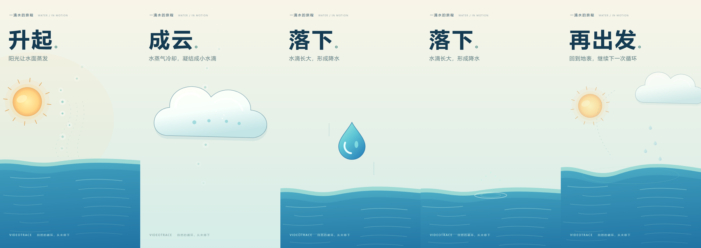

# 视觉实验分支与动画样片

更新日期：2026-10-20。本文对应 `codex/visual-playground`，不是对 `main` 的功能承诺。

## 分支范围

`main` 保留原有版本；视觉组件、全屏画布、镜头和多模态预览检查在实验分支迭代。实验代码已包含在 `546b067` 与 `f3fcf32`；本文、公开样片及新的设计提示词在此基础上补充。

本分支的主渲染链路仍是 Python / Pillow / MoviePy / FFmpeg。React / Remotion 位于独立目录 `experiments/visual-playground/`，没有接管 Java/Python 创作任务，也没有把 Vue 主站改成 React。模型仍提交结构化 JSON，系统不执行模型生成的绘制代码。

## 可观看的效果

四条视频均为 15 秒、720×1280、24 FPS，含背景音乐。点击 MP4 链接观看或下载；PNG 用于直接浏览构图。所有素材均为本项目绘制的组件和内置音乐，不包含上传用户的原始视频。

| 样片 | 内容与制作方式 | 文件 |
| --- | --- | --- |
| Remotion 绘制对照 | 复用已有 Agent 水循环分镜，开发时编写 React/SVG 渲染效果；主要改变排版、渐变和阴影，构图及动作仍沿用旧分镜 | [MP4](../examples/visual-playground/remotion-comparison/demo-15s.mp4) · [预览](../examples/visual-playground/remotion-comparison/preview.png) · [分镜](../examples/visual-playground/remotion-comparison/storyboard.json) · [验证](../examples/visual-playground/remotion-comparison/verification.json) |
| 《一滴水的旅程》 | 独立 Remotion 镜头设计：水面蒸发、云层近景、雨滴下落、触水涟漪与收尾远景；开发时手工编排，不是创作 Agent 自动生成的镜头 | [MP4](../examples/visual-playground/remotion-journey/demo-15s.mp4) · [预览](../examples/visual-playground/remotion-journey/preview.png) · [验证](../examples/visual-playground/remotion-journey/verification.json) |
| Agent + 多模态预览检查 | DeepSeek 在合成水循环证据上自主检索、生成分镜、检查两次、修改并保存，再由 Python 渲染；没有手工替换模型分镜 | [MP4](../examples/visual-playground/agent-preview-review/demo-15s.mp4) · [预览](../examples/visual-playground/agent-preview-review/preview.png) · [分镜](../examples/visual-playground/agent-preview-review/storyboard.json) · [检查反馈](../examples/visual-playground/agent-preview-review/review-feedback.json) · [验证](../examples/visual-playground/agent-preview-review/verification.json) |

### 新设计 Prompt 单次对照

新增 [Prompt v1 样片](../examples/visual-playground/prompt-design-v1/demo-15s.mp4) · [前后构图对照](../examples/visual-playground/prompt-design-v1/comparison.png) · [分镜](../examples/visual-playground/prompt-design-v1/storyboard.json) · [反馈](../examples/visual-playground/prompt-design-v1/review-feedback.json) · [验证记录](../examples/visual-playground/prompt-design-v1/verification.json)。同样使用合成水循环证据、`deepseek-flash`、15秒、Python渲染及相同测试脚本的 `--full --review` 参数。

| 项目 | 原 Prompt 的已保留样片 | 新设计 Prompt v1 |
| --- | --- | --- |
| 分镜阶段耗时 | 34.8秒 | 26.58秒 |
| 多模态预览次数 | 2 | 1 |
| 云主体分镜盒尺寸 | 300×200 | 420×300，另有两朵辅助云 |
| 结构修复错误 | 0 | 0 |
| 最终分镜匹配最后检查版本 | 否 | 否 |

人工观察：新输出的主体更大，降雨在后续抽样时刻更明显；但下落水滴经过底部字幕区域，存在视觉干扰，仍需处理。多模态在检查版本中只报告了一条置信度0.35的主体大小建议，不能据此说最终版本没有其他问题。模型在检查后继续修改，最终输出没有复检。

这是保留原始输出的单次比较。模型采样具有随机性；耗时和检查次数减少不等于质量稳定提高，不能作为性能提升数据。此前三条样片保留为不同制作方式的对照。



### 验证边界

- 两条 Remotion 视频是独立渲染试验，不代表该引擎已接入线上任务，也不代表通用画布适配已经完成。
- Agent 测试使用真实模型与 LangGraph Tool Calling，但证据来自明确标注的合成科普文本；没有重新执行真实视频上传、ASR/OCR、Java 检索或 MinIO 上传。
- 多模态测试成功运行两次预览检查、一次保存，分镜阶段约 34.8 秒，无结构修复错误。第二次检查仍有低置信度建议，不能称为全部视觉问题已解决。
- Agent 在最后一次检查后继续修改了分镜，最终分镜指纹与最后检查指纹不同。因此该样片不能称为最终版本已通过多模态检查。当前工具提交日志会显式记录 `matchesSavedDraft`。
- 前三条样片早于设计 Prompt 调整；新增 Prompt v1 视频单独记录一次对照，不能据此声称稳定提升。

## 动画能力

| 能力 | 默认 `framed` | 实验 `full` |
| --- | --- | --- |
| 画面组织 | 固定标题、要点与中间安全区 | 无固定标题/页脚，文字和物体自行组合 |
| 元素数 / 单元素关键帧 | 20 / 4 | 40 / 12 |
| 坐标 | 物体保持在 x=40..680、y=360..980 安全区 | 中心与路径控制点 x=-720..1440、y=-1280..2560，允许裁切与画外入场 |
| 尺寸 / 字号 / 缩放 | 宽≤640、高≤600；字号16..64；缩放0.25..2 | 宽高≤1280；字号16..160；缩放0.25..4 |
| 镜头 | 无 | 最多8个关键帧，中心平移、zoom=0.5..3 |
| 物体状态 | 位移、缩放、透明度、旋转、脉冲、曲线路径 | 同左，并可随镜头运动 |

物体组件 `sprite` 包含 `sun/earth/cloud/droplet/factory/truck/water/ripple`；另保留基础形状、文字、10种图标及连线。`water/ripple` 可横向拉伸。每个 `curve` 是四个控制点的三次贝塞尔路径，可驱动物体，也可用于 `kind=path` 的流动光点。它不是任意 SVG 路径或绘图代码。

`continuePrevious=true` 使同 ID、同类型的 `world` 物体继承前幕最终状态。`full` 镜头也可继承；0ms关键帧可显式覆盖。`space=screen` 的文字和底衬固定于屏幕，不随镜头移动或继承前幕位置，并绘制在场景物体之上。

仍保留有限时长、元素数量、调用预算和单图层最多800万像素等约束。旋转按外接圆保守估算资源；放开构图不等于放开执行任意代码或读取文件。

## 多模态预览工具

```text
检索证据 → 准备完整候选分镜
                  ↓
review_storyboard_preview
  结构/证据/修改范围校验
  选择最多3幕，每幕20%/50%/80%处取帧
  本地渲染 → 每幕拼成一张三帧预览图
  多模态检查 → 结构化建议返回 Agent
                  ↓
Agent 决定修改或保存，最多检查两次
                  ↓
用户确认分镜后，才生成最终 MP4
```

工具参数为 `{storyboard: 完整分镜, sceneIds?: 最多3个场景ID, focus?: 检查重点}`。省略 `sceneIds` 时选择首、中、末幕；反馈包含场景、抽样时间、问题类别、建议和置信度。只允许引用已采样的场景与时间。

预览检查复用 `CREATOR_VISION_BASE_URL/CREATOR_VISION_API_KEY/CREATOR_VISION_MODEL`，与查看原视频的 `inspect_video_frame` 使用同一套可修改配置，但职责不同。前者看生成画面，后者看绑定原视频内的证据帧。预览图片会发送给配置的模型服务。

成功结果在本地 `CREATOR_DATA_DIR/preview-reviews/` 按操作、分镜、选帧、检查重点、字体、渲染版本和模型标识缓存；日志只保存哈希与反馈，不保存 base64 图片。缓存能复用已完成结果，不能保证网络故障时外部模型恰好调用一次。

反馈是建议，不是新的原视频事实或自动发布许可。检查失败时仍允许保存合法分镜供人工审阅，但不能声称检查成功。抽样帧不能证明全部动画顺滑、音频正常或事实正确。

## Prompt 的设计方向

`creator/agent.py` 现在要求按“解释目标 → 主体 → 主动作 → 开始/变化/结果 → 镜头 → 文字”组织画面，主要约束包括：

1. 每幕突出一个主要动作，让物体解释过程，避免只换标题。
2. 用近景强调变化、远景交代关系，镜头移动应带来信息。
3. 用相同物体或动作结果承接下一幕，合理继承状态。
4. 标题使用屏幕空间，主体使用场景空间，保持明确主次。
5. 动作到达目标前保持可见；循环路径与一次性动作分别设计。
6. 预览重点围绕本次设计的不确定处，优先修复可读性问题。

这些是模型设计指导，不是画面质量保证。本次已按相同证据、模型、时长和渲染器记录一次对照。后续应增加重复样本，并检查动作与字幕区域的空间冲突，分别记录工具次数、问题修复及人工观感。

## 本地复现

```powershell
# 使用已配置的文本及多模态模型，会产生外部 API 调用
creator/.venv/Scripts/python.exe scripts/smoke-animation-model.py --full --review

# 独立 Remotion 手工镜头试验，不调用模型
cd experiments/visual-playground
npm ci
npm run preview:journey
npm run render:journey
```

Remotion 可用 `REMOTION_BROWSER_EXECUTABLE` 指定浏览器；本机 Edge 存在时优先使用，否则由 Remotion 处理浏览器准备。音乐从仓库内置素材复制。依赖、浏览器缓存、构建产物和运行时文件不加入版本管理。

本轮 Python 回归为43项通过；Java相关测试14项通过、前端37项及构建通过来自此前画布升级验收。不同阶段的结果不能合并描述为同一次全链路验收。
